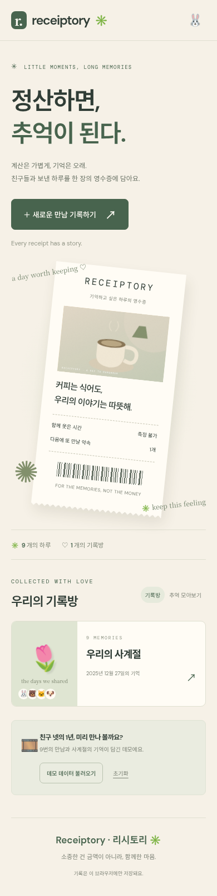
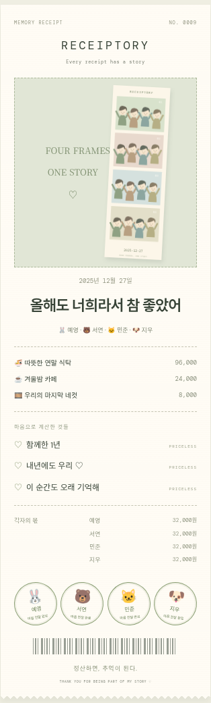
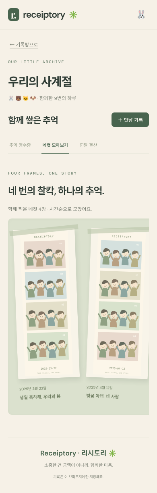
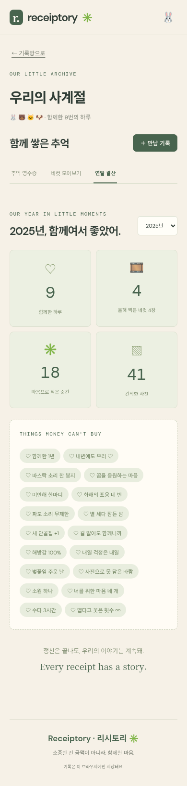

# Receiptory (리시토리) ✳

**Every receipt has a story**  
**정산하면, 추억이 된다.**

친구들과의 결제·정산을 추억으로 간직하는 관계 기록 웹앱입니다. 금액보다 함께한 사진, 장소, 감정이 화면의 중심에 있습니다. 대학 수업 과제와 포트폴리오를 위한 모바일 우선 프로토타입이며, 기존 과제 Word 문서는 저장소에 보존되어 있습니다.

## 실행 방법

Node.js 24와 npm을 사용합니다. 버전은 `.nvmrc`, 의존성은 `package-lock.json`으로 고정합니다.

```bash
npm ci
npm run dev
```

```bash
npm run test       # Vitest: 정산, 기록방, IndexedDB, 사진 매칭, 데모, 동선, 포토부스, 연간 집계
npm run build      # TypeScript 검사 및 정적 사이트 빌드
npm run preview    # 빌드 결과 확인
```

실제 Chromium 모바일 검증도 포함합니다.

```bash
npx playwright install chromium
npm run test:e2e
```

Linux에서 `/usr/bin/chromium`이 있으면 해당 브라우저를 사용하고, 그 외에는 Playwright Chromium을 사용합니다. 클라우드에서 npm 캐시의 쓰기 권한이 제한되면 `npm ci --cache /tmp/receiptory-npm`을 사용합니다.

## 기능

- **정산 엔진:** 균등 분할, 항목별 참여자 선택, 정수 비율·가중치, 특정 인원 제외, 여러 명 결제. 원 단위 계산과 최소 송금 목록.
- **기록방:** 순서와 무관한 멤버 집합으로 자동 생성, 같은 친구들의 만남 누적, 세 번째 만남부터 방 이름 제안. 친구별 이모지 반응과 100자 댓글. 채팅 기능 없음.
- **사진:** JPG·PNG·WebP·GIF 다중 업로드, exifr로 촬영 시각·GPS 추출, 지출 시각 ±90분 이내의 가장 가까운 장소에 연결. 메타데이터 부족/범위 밖은 수동 선택. 여러 친구의 사진을 장소별로 함께 보기, 대표 사진 변경.
- **감성 영수증:** 감열지 질감, 점선·바코드, 날짜·멤버·각자의 부담액, 사용자가 적는 감정 항목. 친구별 송금 완료 도장, 전원 확인 시 필름 현상 애니메이션. 긴 내용도 전체가 들어가도록 축소해 **1080×1920(9:16) PNG** 저장.
- **동선:** Leaflet + OpenStreetMap, 사진 GPS를 촬영 시각순으로 연결. 카페·식당·술집·숙소·기타 스티커. 같은 지출 장소의 사진은 첫 촬영 위치 하나로 묶음. 사진 위치를 잇는 선이며 실제 도로 경로를 계산하지 않음.
- **네컷 연동:** 설정 파일의 7종 포토부스 키워드 자동 분류와 안내 배너. html5-qrcode로 휴대폰 카메라 또는 QR 이미지를 읽고, 확인한 웹 링크를 만남에 저장한 뒤 새 탭으로 열기. QR 없이 네컷 이미지 직접 업로드. 네컷 대표 사진 우선, 세로 필름 형태 표시, 기록방의 시간순 가로 앨범, 연말 `올해 찍은 네컷 N장` 집계.
- **친구 프로필:** 이름·계좌 등록, 친구 추가, 한 기기에서 기록하는 친구 전환.
- **로컬 저장:** 사진 Blob을 포함한 모든 데이터는 IndexedDB. 백엔드, 회원가입, 온라인 공유 없음.
- **시연:** 첫 화면의 `데모 데이터 불러오기` / `초기화` 버튼.

## 정산 알고리즘

순수 함수 모듈 `src/engine/settlement.ts`를 UI·DB와 분리했습니다.

1. 결제 합과 지출액을 검증하고 분배 대상을 선택합니다. 돈은 0 이상의 안전한 정수(원)이며, 가중치도 0 이상의 정수입니다.
2. `BigInt(금액) × 가중치 ÷ 전체 가중치`의 내림값을 각자의 부담액으로 계산합니다. 남은 원 단위는 **payments 배열의 첫 결제자**에게 모두 귀속합니다. 제외된 결제자에게도 나머지만 귀속되며, 분배액 합은 지출액과 항상 일치합니다. 여러 결제자의 순서는 입력 폼의 친구 표시 순서입니다.
3. 각 멤버의 **낸 돈 − 부담할 돈 = 순액**을 계산합니다. 순액 합은 0원입니다.
4. 그리디로 최대 `순액이 0이 아닌 인원 − 1`회인 상한을 먼저 구합니다. 항상 최소인 것은 아니므로 반대 부호 순액의 상쇄를 탐색하고 하한과 메모이제이션으로 가지치기해 **전역 최소 송금 횟수**를 구합니다. 최소화 과정에서 친구를 경유하는 송금이 생길 수 있습니다. 최악의 시간 복잡도는 지수적이므로 소규모 친구 모임에 적합합니다.

필수 예시: A 400,000원 / B 120,000원 / C 40,000원 / D 0원. 모두 140,000원씩 부담하고 **D→A 140,000원, C→A 100,000원, B→A 20,000원**으로 정산합니다. 작은 순액 조합은 독립적인 0원 부분집합 분할 최적값과 비교하는 테스트를 포함합니다.

송금 완료는 사용자가 직접 체크하는 시연 기능입니다. 앱은 실제 송금 여부를 확인하지 않고, 돈을 보관하거나 이체하지 않습니다. 계좌 복사만 지원하며 토스·카카오페이 링크는 `src/config/transferApps.ts`에서 `null` placeholder입니다. 공식 문서로 확인한 URL을 넣기 전에는 연결하지 않습니다.

## 친구 넷의 1년 시연

`데모 데이터 불러오기`로 예영·서연·민준·지우의 **2025년 9개 만남**을 추가합니다. 떡볶이, 생일, 벚꽃, 시험 끝, 골목 카페, 1박 2일 여행, 화해한 날의 술자리, 가을 산책, 연말 식탁이 있습니다. 만남마다 지출 2~5건, 감정 항목, 댓글, GPS 사진이 있습니다. 생일·벚꽃·시험 끝·연말의 **4개 만남**에는 포토부스 지출과 직접 생성한 네컷 placeholder(4칸 프레임 + 파스텔 단색 + 날짜)가 있습니다. 데모 이미지는 직접 생성한 SVG 일러스트로, 실제 촬영 사진이 아닙니다. 재실행해도 중복되지 않고 기존 기록을 보존합니다.

권장 녹화 순서:

1. 데모 불러오기 → `우리의 사계절` 기록방 열기.
2. 최신 연말 카드의 `지우 송금 완료` 클릭 → 도장과 전체 현상 애니메이션.
3. 감정 한 줄 추가 → PNG 저장.
4. `네컷 모아보기` → 시간순 필름 가로 스크롤 → `연말 결산`에서 네컷 4장 확인.
5. 연말 만남에서 `네컷 붙이기` → QR 스캔 → 링크 저장·새 탭 열기 또는 네컷 파일 업로드.
6. 사진 앨범과 동선 지도 열기 → 여행 영수증 확인.
7. 새 만남 작성 → 사진 업로드 → 장소 수동 지정 → 새로고침 후 복원 확인.

## GitHub Pages 배포

`vite.config.ts`의 `base: './'`로 `/2026Fall/`와 같은 하위 경로에서 자산을 불러옵니다. 화면 전환은 클라이언트 상태를 사용해 별도 서버 라우팅이 필요하지 않습니다.

1. 저장소 **Settings → Pages → Source → GitHub Actions**를 선택합니다.
2. 구현 커밋을 `main`에 반영하거나 Actions의 **Deploy Receiptory to GitHub Pages**에서 `workflow_dispatch`를 실행합니다.
3. 워크플로는 `npm ci` → 테스트 → 빌드 → Pages 업로드·배포를 수행합니다.

워크플로 파일을 포함했으며 이 작업 중 실제 원격 배포를 실행하지는 않습니다. 배포 주소와 개발 주소는 서로 다른 origin이므로 로컬 IndexedDB 데이터가 자동 이전되지 않습니다. 배포 화면에서 데모를 다시 불러오면 됩니다.

## 화면 스크린샷

| 홈 (390px) | 감성 영수증 |
| --- | --- |
|  |  |

추가 스크린샷 자리: 사진별 장소 매칭 / 이동 동선 / 새 만남 작성.

| 네컷 모아보기 | 연말 결산 |
| --- | --- |
|  |  |

시연 영상 링크: 제출 후 추가.

## 네컷 QR 사용 방법

1. 만남의 `네컷 붙이기`를 열고 `QR 스캔`을 누릅니다.
2. `카메라로 스캔`을 선택하고 카메라 권한을 허용합니다. 카메라는 **HTTPS 또는 localhost**에서 사용할 수 있습니다. 카메라가 없으면 `QR 이미지로 읽기`로 저장한 QR 이미지를 선택하거나 링크를 직접 붙여넣습니다.
3. 읽은 웹 주소를 확인하고 `링크 저장하고 새 탭 열기`를 누릅니다. http(s) 주소만 허용하며 실행 코드·자격증명 포함 링크는 거부합니다. 스캐너를 닫거나 링크를 열 때 카메라 스트림을 종료합니다.
4. 업체 페이지에서 사용자가 사진을 저장한 다음, 앱의 `네컷 이미지 업로드`로 올립니다. QR 없이 업로드해도 됩니다.

**QR 링크는 기간이 지나면 만료돼요. 사진을 저장한 뒤 아래에서 올려 주세요.** 업체별 URL/API를 추측하거나 다운로드 페이지의 이미지를 자동 수집하지 않습니다. 팝업이 차단되면 저장된 QR 링크를 직접 누르면 됩니다. 포토부스 업체와 연결된 실제 API는 없습니다.

키워드는 `src/config/photoBooth.ts` 배열에서 수정합니다. 매칭은 공백·대소문자를 정규화한 부분 문자열 기준입니다. 네컷을 업로드하면 일반 대표 사진보다 우선하며, 여러 네컷 중에서는 선택한 대표 네컷을 존중합니다. 연말 집계는 QR 링크 수가 아닌 저장된 네컷 이미지 수이며 **만남의 한국 시간 연도** 기준입니다.

카메라는 Chromium의 테스트 스트림으로 시작·종료를 검증했고 실제 QR 이미지 디코딩도 검증합니다. 실물 휴대폰 카메라·업체 페이지 다운로드는 시연 기기에서 확인해 주세요.

## 데이터와 한계

- 기록은 현재 브라우저·origin에만 저장됩니다. 시크릿 모드, 사이트 데이터 삭제, 브라우저 저장 공간 정리 시 사라질 수 있습니다. `초기화`는 확인 후 모든 사진·계좌·댓글·기록을 삭제합니다.
- 업로드는 한 번에 20장, 한 장 20MB 이하입니다. HEIC는 JPG로 변환해 주세요. 용량이 부족하면 저장 오류를 표시합니다.
- EXIF에 UTC 오프셋이 있으면 적용합니다. 오프셋 없는 EXIF는 기기의 시간대를 사용하므로 다른 시간대 사진은 직접 장소를 수정해 주세요. 화면 날짜는 한국 시간 기준입니다.
- OSM 지도 배경은 인터넷 연결이 필요합니다. 이 클라우드에서는 `tile.openstreetmap.org` 허용을 환경 설정 초안에 저장했으며, 설정 저장·게시 후 적용됩니다. 타일 로드 실패 시 안내를 표시하고 장소 목록과 GPS 마커를 유지합니다. 데모 이미지와 글꼴은 외부 이미지 서버 없이 동작합니다.
- 금전 보관·결제 API·송금 API·계정 인증·서버 동기화 기능이 없는 프로토타입입니다.

## 구조

```text
src/engine/       정산 순수 함수와 테스트
src/data/         IndexedDB, 도메인 모델, EXIF 매칭, 동선, 데모
src/components/   만남 폼, 감성 영수증, 사진 앨범, 지도
src/config/       외부 송금 앱 placeholder, 포토부스 키워드
src/App.tsx       홈, 기록방, 반응·댓글, 프로필
.github/workflows/pages.yml  GitHub Pages 배포
```

React + TypeScript + Vite / idb / exifr / html-to-image / Leaflet / html5-qrcode / Vitest / Playwright. 사용한 서드파티 라이브러리와 글꼴의 라이선스는 각 패키지에 포함되어 있습니다.

## 단계별 커밋

1. 정산 엔진과 Vitest 테스트
2. IndexedDB 기록방·만남·반응·댓글
3. EXIF 사진 매칭과 수동 fallback
4. 감성 영수증·송금 확인·PNG·9회 데모
5. GPS 동선·GitHub Pages·한국어 문서
6. 포토부스 감지·QR·네컷 앨범·연말 결산

## 최종 검증 결과

- 잠금 파일 기준 `npm ci` 재설치 후 `npm run test`: **32개 통과**.
- `npm run build`: TypeScript 검사와 Vite 프로덕션 빌드 성공.
- `npm run test:e2e`: **390px Chromium 시나리오 7개 통과**. 저장·복원, 사진 매칭 fallback, 반응·댓글, 완료 연출, PNG 1080×1920, 네컷 업로드·앨범·연간 집계, 실제 QR 이미지 디코딩, 테스트 카메라 종료, 계좌 복사, 초기화 확인 포함.
- 빌드 결과를 `/2026Fall/`에 마운트한 정적 서버에서 자산 로드, 데모, 네컷 앨범, 연말 집계 검증 성공.
- 현재 클라우드의 OSM 실시간 타일 요청은 네트워크 정책으로 **403**. 허용 도메인 초안을 저장했고, 실패 시 GPS 마커·경로·장소 목록은 검증했습니다. 원격 GitHub Pages 배포와 실물 휴대폰 카메라는 아직 실행·검증하지 않았습니다.
